# Cooked with Love — Manual

*A restaurant simulator for the Amstrad CPC 6128*

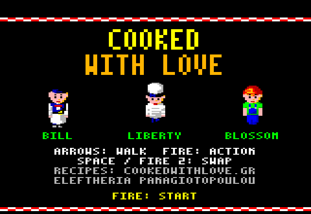

You run a small Greek restaurant. The dishes on its menu come from the
[Cooked with Love](https://www.youtube.com/@CookedwithLove) channel and
[cookedwithlove.gr](https://www.cookedwithlove.gr/). Seat your guests, take
their orders, serve them while they are hot and get paid. Spend what you earn
on a bigger dining room, a bigger kitchen, new recipes and staff, and keep
the restaurant open day after day.

## Contents

1. [Loading the game](#1-loading-the-game)
2. [Controls](#2-controls)
3. [The team](#3-the-team)
4. [Starting a game](#4-starting-a-game)
5. [The screen](#5-the-screen)
6. [The morning: preparing the dishes](#6-the-morning-preparing-the-dishes)
7. [The service](#7-the-service)
8. [The evening: the bill of the day](#8-the-evening-the-bill-of-the-day)
9. [Medium: Liberty's kitchen](#9-medium-libertys-kitchen)
10. [Hard: Blossom's storage](#10-hard-blossoms-storage)
11. [Expansions and staff](#11-expansions-and-staff)
12. [New recipes](#12-new-recipes)
13. [Saving](#13-saving)
14. [Tips](#14-tips)

## 1. Loading the game

You need an Amstrad CPC 6128 (or another CPC with 128K of memory). Insert the
disc (`cwl_en.dsk` in an emulator) and type:

```
RUN"CWL
```

The title screen appears while the rest of the game loads, which takes about
ten seconds. Press **Fire** to start.

The game saves your progress on the disc (see [Saving](#13-saving)), so leave
the disc **write-enabled**. The disc images are in the *Extended DSK* format,
which emulators keep when the game writes to them.

From time to time the screen goes black for a moment. This happens between
the days, and when the camera moves between the kitchen and the storage: the
game is loading from the disc.

## 2. Controls

| Action | Keyboard | Joystick |
|---|---|---|
| Walk, choose | Cursor keys | Stick |
| **Fire**: act, confirm | **COPY** | Fire 1 |
| **Switch character** | **SPACE** | Fire 2 |

Fire does what makes sense where your character stands: at a guest, at a
table, at the pass, at a stove, at a shelf. In the morning and the evening the
cursor keys choose and Fire confirms.

## 3. The team

| Character | Job | Plays from |
|---|---|---|
| **Bill** | The waiter: seats the guests, takes their orders, serves, collects the money, clears the tables | Easy |
| **Liberty** | The cook: cooks every dish of every order | Medium |
| **Blossom** | The storage keeper: receives the deliveries, fills the shelves and the hatch to the kitchen | Hard |

You control one character at a time. **SPACE** switches from Bill to Liberty
(Medium and Hard), then to Blossom (Hard only), then back to Bill. When
you leave Liberty or Blossom, she stays where she is and keeps working in
place; Bill just waits. Each morning starts with Bill.

## 4. Starting a game

On the first morning the bottom row of the screen asks for the difficulty:

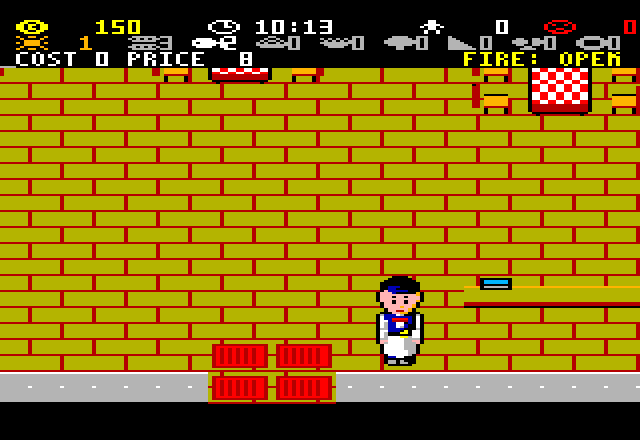

- **EASY**: you are Bill. The kitchen cooks by itself.
- **MEDIUM**: you are Bill and Liberty, the cook.
- **HARD**: you are Bill, Liberty and Blossom, who keeps the storage.
- **CONTINUE**: appears when the disc holds a saved game, and carries it on.

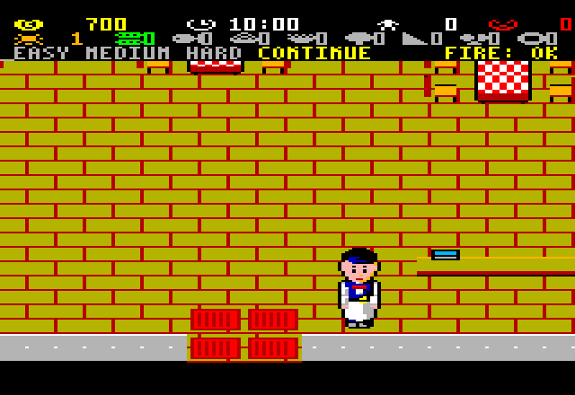

Choose with **left/right** and press **Fire**. You start with **150** coins.

## 5. The screen

The top four rows are the status display (the HUD):

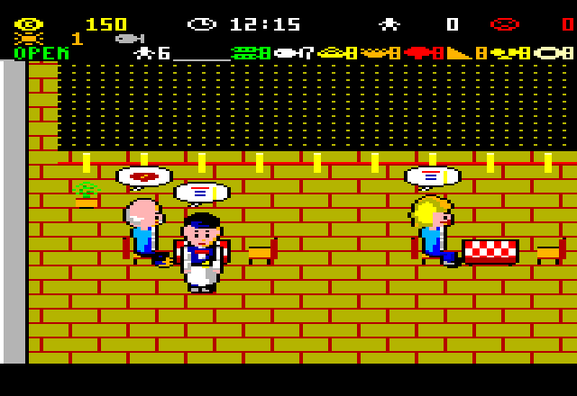

- **Row 1**: your money, the clock, the guests served today, the guests lost
  today (they left unhappy).
- **Row 2**: the day. Then one *ticket* for each order: the dishes it needs.
  A dish is grey while it cooks and shows in its colour when it is waiting at
  the pass. In Hard, a warning icon appears when an ingredient runs low.
- **Row 3**: depends on the moment. During the service it shows whether the
  restaurant is OPEN or CLOSED, how many guests are waiting at the entrance,
  and how many portions of each dish are left (grey when none). In the
  morning and the evening it shows the choices of the moment.

Below the HUD the restaurant scrolls with your character. On the left is the
dining room, in the middle the kitchen with the **pass** (the counter between
kitchen and dining room), and on the right the storage.

## 6. The morning: preparing the dishes

From 10:00 to 12:00 you prepare the portions of the day:

- **left/right** chooses a dish of the menu (row 2, the chosen one in colour),
- **up/down** adds or removes a portion (up to 9 of each dish),
- row 3 shows what a portion **costs** (its ingredients) and its **price** to
  the guests.

Each portion is paid at once, and its preparation moves the clock on. You
cannot prepare more than the two hours allow. In Hard the portions cost no
money, but they take ingredients from the storage (see
[Hard](#10-hard-blossoms-storage)).

Guests can only order what you have prepared. If a group cannot all get a
dish, they leave unhappy. Portions left over in the evening are thrown away.

Press **Fire** to open the restaurant at 12:00.

## 7. The service

The restaurant is open from 12:00 to 15:00. Guests arrive in groups of one to
four and wait at the entrance (at most two groups, six people).

1. **Seat them.** Walk Bill to the waiting group and press **Fire**. They
   follow him. Walk to the spot below a free table that has enough chairs and
   press **Fire**: they sit down.
2. **Take the order.** A notepad bubble means they want to order. Stand at
   their table and press **Fire**. Every guest picks one dish from the
   portions left, and the order goes to the kitchen.
3. **Collect it.** When the order is ready, a plate appears over the **pass**.
   Walk to the pass and press **Fire**: the plates go on Bill's tray.
4. **Serve.** Take them to the table and press **Fire**. The guests eat (a
   heart bubble).
5. **Get paid.** A coin bubble means they want to pay. Press **Fire** at their
   table: you get the price of every dish plus a tip. The group leaves.
6. **Clear the table.** The group leaves its dirty plates on the table. Walk
   there with empty hands, press **Fire** (the plates go on the tray), take
   them to the pass and press **Fire** again. The table cannot take new
   guests until it is cleared.

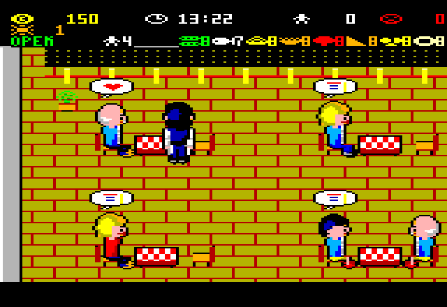

**Patience.** Every group gets impatient while it waits for Bill: at the
entrance, to order, for the food, to pay. Every step you do for them makes
them happier again. An angry bubble is a warning. If their patience runs out
they leave without paying and count as *lost*. Happier guests leave bigger
tips (up to 7 coins).

**More portions during the day.** Press **Fire** at the pass with empty hands
when no order is waiting there. A menu opens on row 3: **left/right** chooses
a dish, **up** orders one more portion (paid at once, cooked by the kitchen in
its time), **Fire** or **down** closes it. The clock and the guests do not
wait while the menu is open.

At 15:00 no more guests arrive. The day ends when the last group has left.

## 8. The evening: the bill of the day

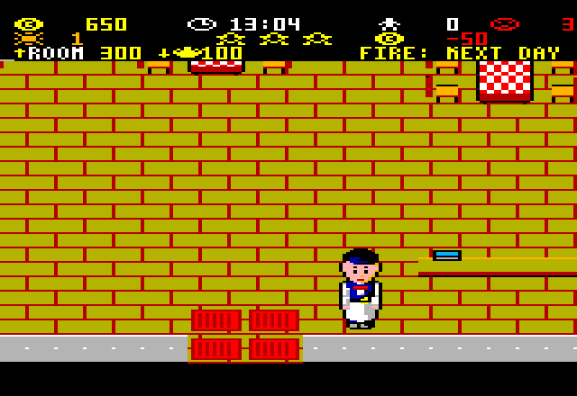

In the evening you pay the **rent** (50 coins) and the **wages** of your staff
(see [Staff](#11-expansions-and-staff)). Row 2 shows the stars of the day and
what you earned:

- ★★★ nobody lost,
- ★★ at least three guests served for every guest lost,
- ★ more served than lost.

If you cannot pay the rent, the restaurant goes **bankrupt**. Press **Fire**
for a new game.

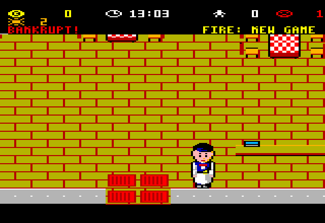

Otherwise row 3 shows what you can buy with the money you have:

- **↑** with a name and a price: an expansion or new staff. **Up** buys it.
  **Left/right** shows the next one on offer.
- **↓** with an icon and a price: a new recipe. **Down** buys it.
- **Fire: next day.** In Hard the supplier comes first (see
  [Hard](#10-hard-blossoms-storage)).

## 9. Medium: Liberty's kitchen

In Medium and Hard nothing cooks by itself: Liberty cooks every dish. Press
**SPACE** to become Liberty.

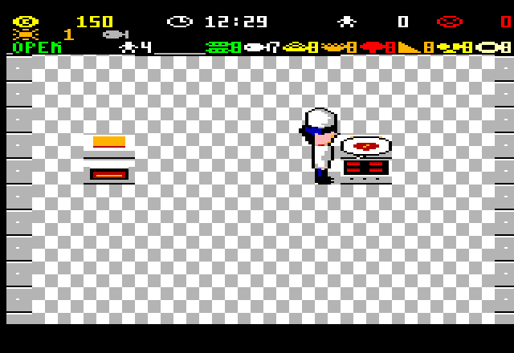

- Each dish cooks on a **stove** or in an **oven**. Each stove and oven holds
  one dish at a time.
- Walk Liberty next to a free stove or oven and press **Fire**. The next dish
  of that kind, from the oldest order waiting, starts cooking there (a "..."
  bubble).
- When it is done a plate bubble appears. Press **Fire** there to take the
  plate (it shows over her head), walk to the **pass** and press **Fire** to
  leave it. On the ticket the dish turns from grey to its colour.
- When all the dishes of an order are at the pass, the order is ready for
  Bill.
- **Watch the time!** A dish left on the stove for ten seconds after it is
  done **burns** (an angry bubble). A burnt dish can still be served, but the
  guests lose patience over it and tip less.

While an order waits for the kitchen, the guests lose patience at half the
usual rate.

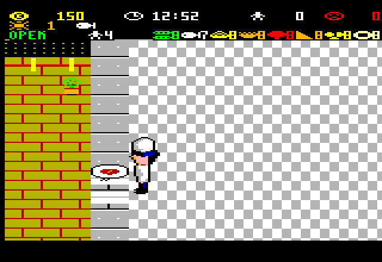

## 10. Hard: Blossom's storage

In Hard the kitchen works as in Medium, and every dish also needs
**ingredients** from the storage. There are five groups: vegetables, meat and
fish, grains and flour, dairy, and pulses. Meat, fish and dairy are kept in
the fridges, everything else on the shelves.

- The morning's portions take one unit of each group they need from the
  shelves.
- The portions cooked during the day take their units from the **hatch**, the
  window between storage and kitchen. Blossom keeps it filled.
- When you control Blossom, row 3 shows every group: its units on the shelves
  and, in grey, at the hatch.

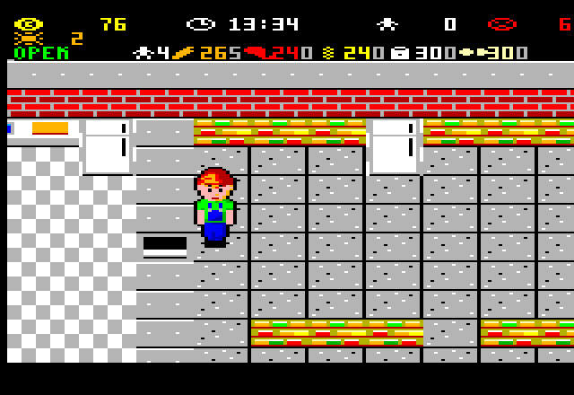

Blossom's work, with **Fire**:

- at the **delivery door**, with empty hands: she takes a box (5 units of a
  group);
- at a **shelf** (or a **fridge**, for meat, fish and dairy): carrying a box,
  she puts it there. With empty hands, she takes 5 units of the group of that
  kind the hatch has least of;
- at the **hatch**, carrying: she leaves the units there for the kitchen.

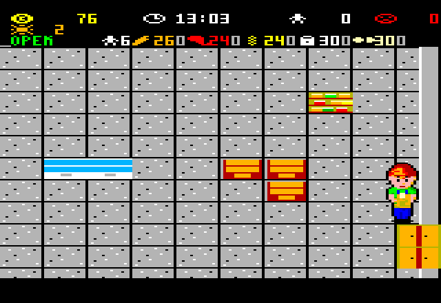

**The supplier.** Each evening, after the bill, you order boxes for the next
day:

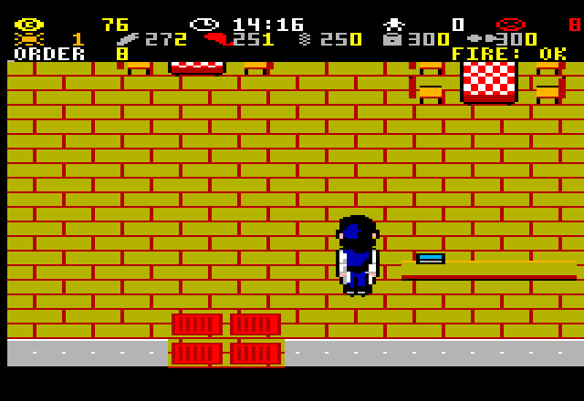

**left/right** chooses a group, **up/down** adds or removes a box (8 coins
each, up to 9), **Fire** confirms. The boxes arrive at the delivery door at
13:00 the next day. Whatever is still at the door in the evening goes off.

When a group falls below 10 units on the shelves, its icon appears on row 2
as a warning.

## 11. Expansions and staff

Everything here is bought in the evening with **up** (left/right shows the
next offer). Only the ones you can afford are offered.

| Offer | Price | Wage per day | What it does |
|---|---|---|---|
| **ROOM** | 300 | — | Opens the upper dining room: six more tables. |
| **KITCHEN** | 250 | — | Opens the lower kitchen: two more stoves and an oven. In Easy the dishes cook in about 2/3 of the time. |
| **STORAGE** | 150 | — | Hard only. The shelves hold up to 99 units of each group. At the door Blossom carries two boxes at once, and at a shelf she takes what fills the hatch. |
| **WAITER** | 100 | 20 | A waiter who looks like Bill. He waits at the pass, takes each ready order to its table and serves it. |
| **COOK** | 100 | 20 | Medium and Hard. A cook who looks like Liberty. He starts the dishes at the stoves and ovens and brings the finished plates to the pass. |
| **HELPER** | 100 | 20 | Hard only. A helper who looks like Blossom. He shelves the boxes from the delivery door and refills the hatch from the shelves. |
| **WAITER** (2nd) | 100 | 20 | Offered after the first waiter. |
| **COOK** (2nd) | 100 | 20 | Offered after the first cook. |

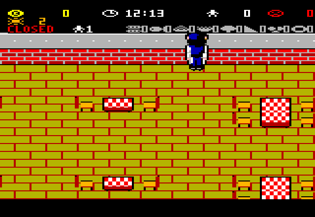
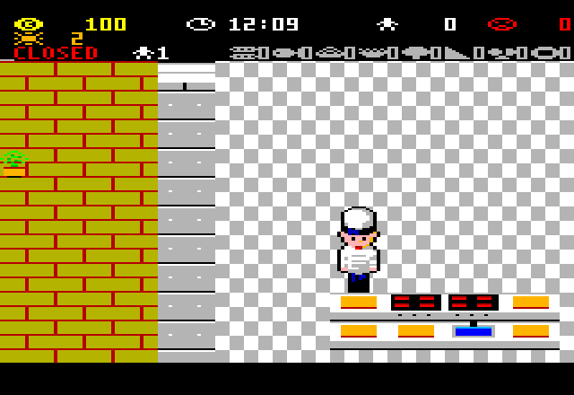

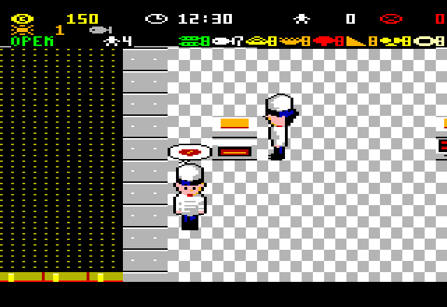
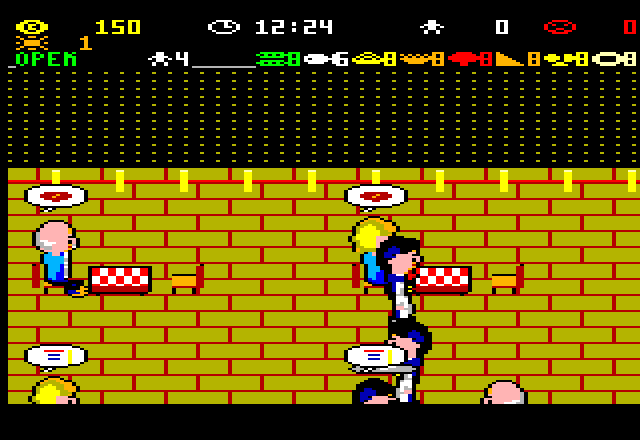

Hired staff work on their own and walk the restaurant like everyone else.
You do not control them. Their wages are paid with the rent every evening,
so they must earn their keep.

## 12. New recipes

The first menu has eight dishes:

| Dish | Course | Price | Cooks on | Ingredients (Hard) |
|---|---|---|---|---|
| Dolmadakia with minced meat | starter | 8 | stove | vegetables, meat, grains |
| Breaded cod | starter | 8 | stove | fish, grains |
| Pasta with Philadelphia cheese and tuna | main | 12 | stove | grains, dairy, fish |
| Lentils without tomato sauce | main | 12 | stove | pulses, vegetables |
| Pork in red sauce with potatoes and carrots | main | 12 | stove | meat, vegetables |
| Pumpkin pie with red pumpkin and feta | main | 12 | oven | vegetables, dairy, grains |
| Oven-roasted potatoes | side | 6 | oven | vegetables |
| Italian lemon cookies | sweet | 7 | oven | grains, dairy |

A portion's ingredients cost about 40% of its price.

In the evening the **↓** offer shows the next new recipe with its icon. It
costs 100 for the first one and 25 more for each one after. **Down** buys it.
The next morning row 3 shows it as NEW: choose with **left/right** the dish of
the menu it replaces and press **Fire**. The menu always has eight dishes.

The recipes to discover, in order: chicken with curry, peppers and rice;
swordfish in red sauce; leek pie with mushrooms; artichokes with mushrooms in
lemon sauce; beef and spinach soup; veal in red sauce with mushrooms;
oven-baked trout with potatoes; stuffed baby squid with quinoa.

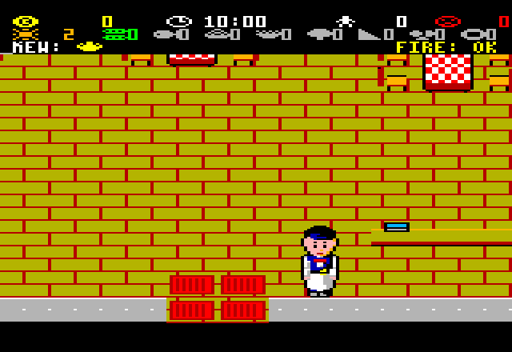

## 13. Saving

The game saves by itself **every morning** (from the second day on): your
money, the day, the difficulty, everything you have bought and hired, your
recipes and the storage. The screen goes black for about two seconds while it
writes.

When you load the game again, the first morning offers **CONTINUE** after the
difficulty levels. Choose it and press **Fire**, and the game carries on from
the morning of that day. Choosing a difficulty instead starts a new game. The
old save stays until the second morning of the new game replaces it.

If the disc is write-protected, the border flashes red for a moment and the
game goes on without saving.

## 14. Tips

- Prepare more of the cheap dishes than you think. A group with nothing to
  order is a group lost.
- Seat the queue first. A waiting queue loses patience fastest, and new
  guests cannot arrive while it is full.
- Bill's tray holds one order at a time. Clear a dirty table when you walk
  past it with empty hands: the next group needs it.
- In Medium, start the next dish before you carry the last one: the stove
  works while Liberty walks.
- In Hard, order a few boxes every evening and keep the hatch full in the
  quiet moments of the day.
- A waiter pays for himself quickly in a full dining room. Buy the room
  before the staff.

---

*Cooked with Love* for the Amstrad CPC. Recipes ©
[cookedwithlove.gr](https://www.cookedwithlove.gr/) (Ελευθερία
Παναγιωτοπούλου), used by name only: the full recipes are on the site.
