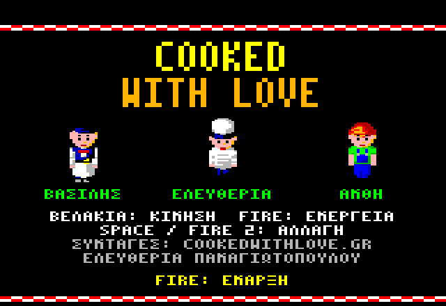

# Cooked with Love — Εγχειρίδιο

*Προσομοιωτής εστιατορίου για τον Amstrad CPC 6128*



Διευθύνεις ένα μικρό ελληνικό εστιατόριο. Τα πιάτα του μενού του έρχονται
από το κανάλι [Cooked with Love](https://www.youtube.com/@CookedwithLove)
και το [cookedwithlove.gr](https://www.cookedwithlove.gr/). Βάλε τους πελάτες
να καθίσουν, πάρε την παραγγελία τους, σέρβιρέ τους όσο το φαγητό είναι ζεστό
και πληρώσου. Με όσα κερδίζεις μεγαλώνεις τη σάλα και την κουζίνα, αγοράζεις
νέες συνταγές και προσλαμβάνεις προσωπικό, για να μείνει το εστιατόριο
ανοιχτό μέρα με τη μέρα.

## Περιεχόμενα

1. [Φόρτωση](#1-φόρτωση)
2. [Χειρισμός](#2-χειρισμός)
3. [Η ομάδα](#3-η-ομάδα)
4. [Νέο παιχνίδι](#4-νέο-παιχνίδι)
5. [Η οθόνη](#5-η-οθόνη)
6. [Το πρωί: η προετοιμασία](#6-το-πρωί-η-προετοιμασία)
7. [Το σέρβις](#7-το-σέρβις)
8. [Το βράδυ: ο λογαριασμός της μέρας](#8-το-βράδυ-ο-λογαριασμός-της-μέρας)
9. [Μεσαίο: η κουζίνα της Ελευθερίας](#9-μεσαίο-η-κουζίνα-της-ελευθερίας)
10. [Δύσκολο: η αποθήκη της Ανθής](#10-δύσκολο-η-αποθήκη-της-ανθής)
11. [Επεκτάσεις και προσωπικό](#11-επεκτάσεις-και-προσωπικό)
12. [Νέες συνταγές](#12-νέες-συνταγές)
13. [Αποθήκευση](#13-αποθήκευση)
14. [Συμβουλές](#14-συμβουλές)

## 1. Φόρτωση

Χρειάζεσαι Amstrad CPC 6128 (ή άλλον CPC με 128K μνήμη). Βάλε τη δισκέτα
(`cwl_gr.dsk` σε emulator) και γράψε:

```
RUN"CWL
```

Η οθόνη τίτλου εμφανίζεται όσο φορτώνει το υπόλοιπο παιχνίδι, περίπου δέκα
δευτερόλεπτα. Πάτα **Fire** για να ξεκινήσεις.

Το παιχνίδι αποθηκεύει την πρόοδό σου στη δισκέτα (δες
[Αποθήκευση](#13-αποθήκευση)), οπότε η δισκέτα πρέπει να **επιτρέπει
εγγραφή**. Οι εικόνες δισκέτας είναι σε μορφή *Extended DSK*, που οι
emulators κρατούν όταν το παιχνίδι γράφει σε αυτές.

Πότε πότε η οθόνη μαυρίζει για λίγο. Γίνεται ανάμεσα στις μέρες και όταν η
κάμερα περνά από την κουζίνα στην αποθήκη και πίσω: το παιχνίδι φορτώνει από
τη δισκέτα.

## 2. Χειρισμός

| Ενέργεια | Πληκτρολόγιο | Joystick |
|---|---|---|
| Περπάτημα, επιλογή | Βελάκια | Μοχλός |
| **Fire**: ενέργεια, επιβεβαίωση | **COPY** | Fire 1 |
| **Αλλαγή χαρακτήρα** | **SPACE** | Fire 2 |

Το Fire κάνει ό,τι ταιριάζει εκεί που στέκεται ο χαρακτήρας σου: σε
πελάτες, σε τραπέζι, στο πάσο, σε εστία, σε ράφι. Το πρωί και το βράδυ τα
βελάκια επιλέγουν και το Fire επιβεβαιώνει.

## 3. Η ομάδα

| Χαρακτήρας | Δουλειά | Παίζεται από |
|---|---|---|
| **Βασίλης** | Ο σερβιτόρος: βάζει τους πελάτες να καθίσουν, παίρνει παραγγελίες, σερβίρει, εισπράττει, μαζεύει τα τραπέζια | Εύκολο |
| **Ελευθερία** | Η μαγείρισσα: μαγειρεύει κάθε πιάτο κάθε παραγγελίας | Μεσαίο |
| **Ανθή** | Η υπεύθυνη της αποθήκης: παραλαμβάνει, γεμίζει τα ράφια και τη θυρίδα της κουζίνας | Δύσκολο |

Ελέγχεις έναν χαρακτήρα τη φορά. Το **SPACE** περνά από τον Βασίλη στην
Ελευθερία (Μεσαίο και Δύσκολο), μετά στην Ανθή (μόνο Δύσκολο) και πάλι στον
Βασίλη. Όταν αφήνεις την Ελευθερία ή την Ανθή, μένει εκεί που είναι και
συνεχίζει να δουλεύει επιτόπου· ο Βασίλης απλώς περιμένει. Κάθε πρωί
ξεκινάς με τον Βασίλη.

## 4. Νέο παιχνίδι

Το πρώτο πρωί η κάτω γραμμή ρωτά για τη δυσκολία:


- **ΕΥΚΟΛΟ**: είσαι ο Βασίλης. Η κουζίνα μαγειρεύει μόνη της.
- **ΜΕΣΑΙΟ**: είσαι ο Βασίλης και η Ελευθερία, η μαγείρισσα.
- **ΔΥΣΚΟΛΟ**: είσαι ο Βασίλης, η Ελευθερία και η Ανθή, που κρατά την
  αποθήκη.
- **ΣΥΝΕΧΕΙΑ**: φαίνεται όταν η δισκέτα έχει αποθηκευμένο παιχνίδι, και το
  συνεχίζει.

Διάλεξε με **αριστερά/δεξιά** και πάτα **Fire**. Ξεκινάς με **150** νομίσματα.

## 5. Η οθόνη

Οι τέσσερις πάνω γραμμές είναι η ένδειξη κατάστασης (το HUD):


- **Γραμμή 1**: τα χρήματά σου, το ρολόι, οι πελάτες που εξυπηρέτησες
  σήμερα και όσοι χάθηκαν σήμερα (έφυγαν δυσαρεστημένοι).
- **Γραμμή 2**: η μέρα. Μετά ένα *ticket* για κάθε παραγγελία, με τα πιάτα
  της. Ένα πιάτο είναι γκρι όσο μαγειρεύεται και παίρνει το χρώμα του όταν
  περιμένει στο πάσο. Στο Δύσκολο εδώ εμφανίζεται και μια προειδοποίηση όταν
  ένα υλικό λιγοστεύει.
- **Γραμμή 3**: αλλάζει με τη στιγμή. Στο σέρβις δείχνει αν το μαγαζί είναι
  ΑΝΟΙΧΤΑ ή ΚΛΕΙΣΤΑ, πόσοι περιμένουν στην είσοδο και πόσες μερίδες έμειναν
  από κάθε πιάτο (γκρι όταν τελείωσαν). Το πρωί και το βράδυ δείχνει τις
  επιλογές της στιγμής.

Κάτω από το HUD το εστιατόριο κυλά μαζί με τον χαρακτήρα σου. Αριστερά είναι
η σάλα, στη μέση η κουζίνα με το **πάσο** (τον πάγκο ανάμεσα σε κουζίνα και
σάλα) και δεξιά η αποθήκη.

## 6. Το πρωί: η προετοιμασία

Από τις 10:00 ως τις 12:00 ετοιμάζεις τις μερίδες της μέρας:

- **αριστερά/δεξιά**: ένα πιάτο του μενού (γραμμή 2, το επιλεγμένο στο χρώμα
  του),
- **πάνω/κάτω**: μία μερίδα παραπάνω ή λιγότερο (ως 9 από κάθε πιάτο),
- η γραμμή 3 δείχνει το **ΚΟΣΤΟΣ** μιας μερίδας (τα υλικά της) και την
  **ΤΙΜΗ** της για τους πελάτες.

Κάθε μερίδα πληρώνεται αμέσως, και η προετοιμασία της προχωρά το ρολόι. Δεν
μπορείς να ετοιμάσεις περισσότερα απ' όσα χωρούν στις δύο ώρες. Στο Δύσκολο
οι μερίδες δεν κοστίζουν χρήματα, παίρνουν όμως υλικά από την αποθήκη (δες
[Δύσκολο](#10-δύσκολο-η-αποθήκη-της-ανθής)).

Οι πελάτες παραγγέλνουν μόνο ό,τι έχεις ετοιμάσει. Αν δεν φτάνουν πιάτα για
όλη την παρέα, φεύγουν δυσαρεστημένοι. Ό,τι μείνει το βράδυ πετιέται.

Πάτα **Fire** για να ανοίξεις στις 12:00.

## 7. Το σέρβις

Το εστιατόριο είναι ανοιχτό από τις 12:00 ως τις 15:00. Οι πελάτες έρχονται
σε παρέες από έναν ως τέσσερις και περιμένουν στην είσοδο (το πολύ δύο
παρέες, έξι άτομα).

1. **Βάλ' τους να καθίσουν.** Πήγαινε τον Βασίλη στην παρέα που περιμένει
   και πάτα **Fire**: τον ακολουθούν. Πήγαινε στο σημείο κάτω από ένα ελεύθερο
   τραπέζι με αρκετές καρέκλες και πάτα **Fire**: κάθονται.
2. **Πάρε την παραγγελία.** Μια φούσκα με μπλοκάκι σημαίνει ότι θέλουν να
   παραγγείλουν. Στάσου στο τραπέζι τους και πάτα **Fire**. Ο καθένας διαλέγει
   ένα πιάτο από όσα έμειναν, και η παραγγελία πηγαίνει στην κουζίνα.
3. **Πάρ' την από το πάσο.** Όταν η παραγγελία είναι έτοιμη, ένα πιάτο
   φαίνεται πάνω από το **πάσο**. Πήγαινε εκεί και πάτα **Fire**: τα πιάτα
   μπαίνουν στον δίσκο του Βασίλη.
4. **Σέρβιρε.** Πήγαινέ τα στο τραπέζι και πάτα **Fire**. Οι πελάτες τρώνε
   (φούσκα με καρδιά).
5. **Πληρώσου.** Μια φούσκα με νόμισμα σημαίνει ότι θέλουν να πληρώσουν. Πάτα
   **Fire** στο τραπέζι τους: παίρνεις την τιμή κάθε πιάτου και φιλοδώρημα. Η
   παρέα φεύγει.
6. **Μάζεψε το τραπέζι.** Η παρέα αφήνει τα άπλυτα πιάτα στο τραπέζι.
   Πήγαινε εκεί με άδεια χέρια, πάτα **Fire** (τα πιάτα στον δίσκο), πήγαινέ
   τα στο πάσο και πάτα ξανά **Fire**. Το τραπέζι δεν δέχεται νέους πελάτες
   πριν μαζευτεί.


**Υπομονή.** Κάθε παρέα χάνει την υπομονή της όσο περιμένει τον Βασίλη:
στην είσοδο, για να παραγγείλει, για το φαγητό, για να πληρώσει. Κάθε βήμα
που κάνεις γι' αυτούς τους ξαναφτιάχνει τη διάθεση. Μια θυμωμένη φούσκα είναι
προειδοποίηση. Αν η υπομονή τους τελειώσει, φεύγουν χωρίς να πληρώσουν και
μετρούν ως *χαμένοι*. Οι πιο ευχαριστημένοι αφήνουν μεγαλύτερο φιλοδώρημα
(ως 7 νομίσματα).

**Μερίδες μέσα στη μέρα.** Πάτα **Fire** στο πάσο με άδεια χέρια, όταν δεν
περιμένει εκεί καμία παραγγελία. Στη γραμμή 3 ανοίγει ένα μενού:
**αριστερά/δεξιά** διαλέγει πιάτο, **πάνω** παραγγέλνει μία μερίδα ακόμα
(πληρώνεται αμέσως και η κουζίνα τη μαγειρεύει στον χρόνο της), **Fire** ή
**κάτω** το κλείνει. Όσο είναι ανοιχτό, η ώρα και οι πελάτες δεν περιμένουν.

Στις 15:00 δεν έρχονται άλλοι πελάτες. Η μέρα τελειώνει όταν φύγει και η
τελευταία παρέα.

## 8. Το βράδυ: ο λογαριασμός της μέρας


Το βράδυ πληρώνεις το **ενοίκιο** (50 νομίσματα) και τους **μισθούς** του
προσωπικού σου (δες [Προσωπικό](#11-επεκτάσεις-και-προσωπικό)). Η γραμμή 2
δείχνει τα αστέρια της μέρας και το κέρδος σου:

- ★★★ κανένας χαμένος,
- ★★ τουλάχιστον τρεις εξυπηρετημένοι για κάθε χαμένο,
- ★ περισσότεροι εξυπηρετημένοι από χαμένους.

Αν δεν φτάνουν τα χρήματα για το ενοίκιο, το εστιατόριο **πτωχεύει**. Πάτα
**Fire** για νέο παιχνίδι.


Αλλιώς η γραμμή 3 δείχνει ό,τι μπορείς να αγοράσεις με όσα έχεις:

- **↑** με όνομα και τιμή: μια επέκταση ή νέο προσωπικό. Το **πάνω** το
  αγοράζει. Το **αριστερά/δεξιά** δείχνει την επόμενη προσφορά.
- **↓** με εικονίδιο και τιμή: μια νέα συνταγή. Το **κάτω** την αγοράζει.
- **FIRE: ΝΕΑ ΜΕΡΑ.** Στο Δύσκολο πρώτα έρχεται ο προμηθευτής (δες
  [Δύσκολο](#10-δύσκολο-η-αποθήκη-της-ανθής)).

## 9. Μεσαίο: η κουζίνα της Ελευθερίας

Στο Μεσαίο και στο Δύσκολο τίποτα δεν μαγειρεύεται μόνο του: κάθε πιάτο το
μαγειρεύει η Ελευθερία. Πάτα **SPACE** για να γίνεις η Ελευθερία.


- Κάθε πιάτο μαγειρεύεται σε **εστία** ή σε **φούρνο**. Κάθε εστία και
  κάθε φούρνος χωρά ένα πιάτο τη φορά.
- Πήγαινε την Ελευθερία δίπλα σε ελεύθερη εστία ή φούρνο και πάτα **Fire**.
  Εκεί αρχίζει να μαγειρεύεται το επόμενο πιάτο αυτού του είδους από την
  παλαιότερη παραγγελία που περιμένει (φούσκα «...»).
- Όταν είναι έτοιμο, φαίνεται φούσκα με πιάτο. Πάτα εκεί **Fire** για να το
  πάρει (φαίνεται πάνω από το κεφάλι της), πήγαινε στο **πάσο** και πάτα
  **Fire** για να το αφήσει. Στο ticket το πιάτο από γκρι παίρνει το χρώμα
  του.
- Όταν όλα τα πιάτα μιας παραγγελίας είναι στο πάσο, η παραγγελία είναι
  έτοιμη για τον Βασίλη.
- **Πρόσεχε την ώρα!** Ένα πιάτο που μένει στη φωτιά δέκα δευτερόλεπτα αφού
  γίνει **καίγεται** (θυμωμένη φούσκα). Σερβίρεται ακόμα, αλλά οι πελάτες
  χάνουν υπομονή και αφήνουν λιγότερο φιλοδώρημα.

Όσο μια παραγγελία περιμένει την κουζίνα, οι πελάτες χάνουν υπομονή με τον
μισό ρυθμό.


## 10. Δύσκολο: η αποθήκη της Ανθής

Στο Δύσκολο η κουζίνα δουλεύει όπως στο Μεσαίο, και κάθε πιάτο θέλει επιπλέον
**υλικά** από την αποθήκη. Υπάρχουν πέντε ομάδες: λαχανικά, κρέας και ψάρι,
δημητριακά και αλεύρι, γαλακτοκομικά, όσπρια. Το κρέας, το ψάρι και τα
γαλακτοκομικά μένουν στα ψυγεία, όλα τα άλλα στα ράφια.

- Οι μερίδες του πρωινού παίρνουν από τα ράφια μία μονάδα από κάθε ομάδα που
  χρειάζονται.
- Οι μερίδες που μαγειρεύονται μέσα στη μέρα παίρνουν τις μονάδες τους από τη
  **θυρίδα**, το παράθυρο ανάμεσα σε αποθήκη και κουζίνα. Η Ανθή την κρατά
  γεμάτη.
- Όταν ελέγχεις την Ανθή, η γραμμή 3 δείχνει κάθε ομάδα: τις μονάδες της στα
  ράφια και, με γκρι, στη θυρίδα.


Η δουλειά της Ανθής, με **Fire**:

- στην **πόρτα παραλαβής**, με άδεια χέρια: παίρνει ένα κιβώτιο (5 μονάδες
  μιας ομάδας)·
- σε **ράφι** (ή **ψυγείο**, για κρέας, ψάρι, γαλακτοκομικά): αν κρατά
  κιβώτιο, το αφήνει εκεί. Με άδεια χέρια παίρνει 5 μονάδες από την ομάδα αυτού
  του είδους που λείπει περισσότερο από τη θυρίδα·
- στη **θυρίδα**, αν κρατά κάτι: το αφήνει εκεί για την κουζίνα.


**Ο προμηθευτής.** Κάθε βράδυ, μετά τον λογαριασμό, παραγγέλνεις κιβώτια για
την επόμενη μέρα:


**αριστερά/δεξιά** διαλέγει ομάδα, **πάνω/κάτω** ένα κιβώτιο παραπάνω ή
λιγότερο (8 νομίσματα το καθένα, ως 9), **Fire** επιβεβαιώνει. Τα κιβώτια
φτάνουν στην πόρτα στις 13:00 της επόμενης μέρας. Ό,τι μείνει στην πόρτα ως το
βράδυ χαλάει.

Όταν μια ομάδα πέσει κάτω από 10 μονάδες στα ράφια, το εικονίδιό της
φαίνεται στη γραμμή 2 ως προειδοποίηση.

## 11. Επεκτάσεις και προσωπικό

Όλα αυτά αγοράζονται το βράδυ με το **πάνω** (το αριστερά/δεξιά δείχνει την
επόμενη προσφορά). Προσφέρονται μόνο όσα σου φτάνουν τα χρήματα.

| Προσφορά | Τιμή | Μισθός τη μέρα | Τι κάνει |
|---|---|---|---|
| **ΣΑΛΑ** | 300 | — | Ανοίγει την πάνω σάλα: έξι τραπέζια ακόμα. |
| **ΚΟΥΖΙΝΑ** | 250 | — | Ανοίγει την κάτω κουζίνα: δύο εστίες και έναν φούρνο ακόμα. Στο Εύκολο τα πιάτα θέλουν περίπου τα 2/3 του χρόνου. |
| **ΑΠΟΘΗΚΗ** | 150 | — | Μόνο στο Δύσκολο. Τα ράφια χωρούν ως 99 μονάδες κάθε ομάδας. Στην πόρτα η Ανθή κουβαλά δύο κιβώτια μαζί, και από το ράφι παίρνει όσα γεμίζουν τη θυρίδα. |
| **ΣΕΡΒΙΤΟΡΟΣ** | 100 | 20 | Ένας σερβιτόρος σαν τον Βασίλη. Περιμένει στο πάσο, παίρνει κάθε έτοιμη παραγγελία, την πάει στο τραπέζι της και σερβίρει. |
| **ΜΑΓΕΙΡΑΣ** | 100 | 20 | Μεσαίο και Δύσκολο. Ένας μάγειρας σαν την Ελευθερία. Ξεκινά τα πιάτα στις εστίες και στους φούρνους και φέρνει τα έτοιμα στο πάσο. |
| **ΒΟΗΘΟΣ** | 100 | 20 | Μόνο στο Δύσκολο. Ένας βοηθός σαν την Ανθή. Βάζει στα ράφια τα κιβώτια της πόρτας και γεμίζει τη θυρίδα από τα ράφια. |
| **ΣΕΡΒΙΤΟΡΟΣ** (2ος) | 100 | 20 | Προσφέρεται μετά τον πρώτο σερβιτόρο. |
| **ΜΑΓΕΙΡΑΣ** (2ος) | 100 | 20 | Προσφέρεται μετά τον πρώτο μάγειρα. |


Όσοι προσλαμβάνεις δουλεύουν μόνοι τους και περπατούν στο εστιατόριο όπως
όλοι. Δεν τους ελέγχεις εσύ. Οι μισθοί τους πληρώνονται μαζί με το ενοίκιο
κάθε βράδυ, οπότε πρέπει να βγάζουν τα λεφτά τους.

## 12. Νέες συνταγές

Το πρώτο μενού έχει οκτώ πιάτα:

| Πιάτο | Είδος | Τιμή | Μαγειρεύεται | Υλικά (Δύσκολο) |
|---|---|---|---|---|
| Ντολμαδάκια με κιμά | ορεκτικό | 8 | εστία | λαχανικά, κρέας, δημητριακά |
| Μπακαλιάρος πανέ | ορεκτικό | 8 | εστία | ψάρι, δημητριακά |
| Μακαρόνια με τυρί Φιλαδέλφεια και τόνο | κυρίως | 12 | εστία | δημητριακά, γαλακτοκομικά, ψάρι |
| Φακές χωρίς σάλτσα ντομάτα | κυρίως | 12 | εστία | όσπρια, λαχανικά |
| Χοιρινό κοκκινιστό με πατάτες και καρότα | κυρίως | 12 | εστία | κρέας, λαχανικά |
| Κολοκυθόπιτα με κόκκινη κολοκύθα και φέτα | κυρίως | 12 | φούρνος | λαχανικά, γαλακτοκομικά, δημητριακά |
| Πατάτες φούρνου | συνοδευτικό | 6 | φούρνος | λαχανικά |
| Ιταλικά κουλουράκια λεμονιού | γλυκό | 7 | φούρνος | δημητριακά, γαλακτοκομικά |

Τα υλικά μιας μερίδας κοστίζουν περίπου το 40% της τιμής της.

Το βράδυ η προσφορά **↓** δείχνει την επόμενη νέα συνταγή με το εικονίδιό
της. Η πρώτη κοστίζει 100 και κάθε επόμενη 25 παραπάνω. Το **κάτω** την
αγοράζει. Το επόμενο πρωί η γραμμή 3 τη δείχνει ως ΝΕΟ: διάλεξε με
**αριστερά/δεξιά** το πιάτο του μενού που αντικαθιστά και πάτα **Fire**. Το
μενού έχει πάντα οκτώ πιάτα.

Οι συνταγές που ανακαλύπτεις, με τη σειρά: κοτόπουλο με κάρι, πολύχρωμες
πιπεριές και ρύζι· ξιφίας κοκκινιστός· πρασόπιτα με μανιτάρια· αγκινάρες με
μανιτάρια λεμονάτα· σούπα με μοσχάρι και σπανάκι· μοσχαράκι κοκκινιστό με
μανιτάρια· πέστροφες με πατάτες στον φούρνο· γεμιστά καλαμαράκια με κινόα.


## 13. Αποθήκευση

Το παιχνίδι αποθηκεύει μόνο του **κάθε πρωί** (από τη δεύτερη μέρα και μετά):
τα χρήματα, τη μέρα, τη δυσκολία, ό,τι έχεις αγοράσει και όσους έχεις
προσλάβει, τις συνταγές σου και την αποθήκη. Η οθόνη μαυρίζει για περίπου δύο
δευτερόλεπτα όσο γράφει.

Όταν ξαναφορτώσεις το παιχνίδι, το πρώτο πρωί προσφέρει **ΣΥΝΕΧΕΙΑ** μετά τις
δυσκολίες. Διάλεξέ τη και πάτα **Fire**, και το παιχνίδι συνεχίζει από το πρωί
εκείνης της μέρας. Αν διαλέξεις δυσκολία, ξεκινά νέο παιχνίδι. Η παλιά
αποθήκευση μένει ώσπου να την αντικαταστήσει το δεύτερο πρωί του νέου
παιχνιδιού.

Αν η δισκέτα δεν επιτρέπει εγγραφή, το περίγραμμα της οθόνης γίνεται για λίγο
κόκκινο και το παιχνίδι συνεχίζει χωρίς αποθήκευση.

## 14. Συμβουλές

- Ετοίμασε περισσότερες μερίδες από τα φθηνά πιάτα απ' όσες νομίζεις. Μια
  παρέα χωρίς τίποτα να παραγγείλει είναι παρέα χαμένη.
- Βάλε πρώτα την ουρά να καθίσει. Όποιος περιμένει στην είσοδο χάνει πιο
  γρήγορα την υπομονή του, και όσο η ουρά είναι γεμάτη δεν έρχονται νέοι.
- Ο δίσκος του Βασίλη χωρά μία παραγγελία τη φορά. Μάζευε τα άπλυτα όταν
  περνάς από ένα τραπέζι με άδεια χέρια: η επόμενη παρέα το χρειάζεται.
- Στο Μεσαίο, ξεκίνα το επόμενο πιάτο πριν κουβαλήσεις το τελευταίο: η
  εστία δουλεύει όσο περπατά η Ελευθερία.
- Στο Δύσκολο, παράγγελνε λίγα κιβώτια κάθε βράδυ και γέμιζε τη θυρίδα στις
  ήσυχες στιγμές της μέρας.
- Ένας σερβιτόρος ξεπληρώνεται γρήγορα σε γεμάτη σάλα. Αγόρασε τη σάλα πριν
  από το προσωπικό.

---

*Cooked with Love* για τον Amstrad CPC. Συνταγές ©
[cookedwithlove.gr](https://www.cookedwithlove.gr/) (Ελευθερία
Παναγιωτοπούλου), μόνο με το όνομά τους: ολόκληρες οι συνταγές είναι στο
site.
